# Version 1 – Implement Basic Malloc() and Free()

The aim of this task was to build our own versions of `malloc` and `free`, called `smalloc` and `sfree`, to virtually dynamically allocate and deallocate memory on the heap.

Our allocator works by intially requesting one large contiguous block of virtual memory from the operating system using `mmap()`. Each subsequent call to `smalloc()` allocates a sub-block from this region, with the size determined by the number of bytes requested by the caller. As memory is constantly allocated and deallocated, the original region becomes divided into allocated and free sub-blocks of different sizes, meaning the free memory is not one contiguous block but is `fragmented`. To keep track of available memory, we use the data structure `free list`, which is a linked list storing information about each sub-block such as it's memory address, and the size of free memory available.

When `smalloc()` is called, the allocator searches the free list for a block large enough, and if a block is found, it can be split, giving a portion to the caller and any remaining space to the linked list. Similarly, when `sfree()` is called, the previously allocated block is returned to the free list so that it can be reused by future allocation requests. 

Adjacent free blocks can also be merged together to form larger free regions, helping to reduce memory fragmentation.

Note: As an extension, we only split a free block if the leftover part was big enough to be useful.

## get_mem_block()

This function is used to request one large block of memory from the operating system.

```c
void *get_mem_block(void *addr, size_t mem_size)
{
    void *h_ptr = mmap(
        addr,                        // starting address hint (NULL lets kernel choose)
        mem_size,                    // number of bytes requested
        PROT_READ | PROT_WRITE,      // memory should be readable and writable
        MAP_PRIVATE | MAP_ANONYMOUS, // private mapping, not backed by a file
        -1,                          // no file descriptor needed
        0                            // offset must be zero for MAP_ANONYMOUS
    );

    if (h_ptr == MAP_FAILED)
    {
        return NULL; // return NULL if mmap fails
    }
    return h_ptr; // otherwise return the allocated memory
}

```

-   We used `mmap()`, a system call that maps a new region of memory into the process's address space. It is normally used to map files into memory, but we used the `MAP_ANONYMOUS` flag so the memory was not backed by any file, which gave us a block of uninitialised memory.
-   We passed `NULL` as the address so the kernel could choose the starting address for the memory
-   We used `PROT_READ | PROT_WRITE` so the program could read and write the memory, and `MAP_PRIVATE` so the memory belonged only to this process.
-   Because no file was used, we set the file descriptor to `-1` and the offset to `0`.

## init_free_list()

This function is used at initialisation to turn the large block from `get_mem_block()` into a freelist with a single node, representing the whole block of free memory.

```c
void init_free_list(void *mem, size_t mem_size)
{
    //converts the starting memory from type void to type common_header 
    list_head = (common_header_t *)mem;
    list_head->size = (int)(mem_size - sizeof(common_header_t));
    list_head->next = NULL;
}

```
-   Every block of memory, free or allocated, begins with a `common_header_t` header. It stores the number of bytes of data the block could hold and, a pointer to the next node of the freelist.
-   The assignment stated that the header took up 8 bytes, as the pointer and integer variable within the struct both have a width of 4 bytes. This is only true on a typical 32-bit system, as on a 64-bit system the pointer takes up 8 bytes, int takes up 4 bytes and an additional 4 bytes of padding, bringing the total header size to 16 bytes. To account for this difference, we used `sizeof(common_header_t)` throughout the code, so our allocator could work across both 32-bit and 64-bit systems.
-   We converted the start of the block from `void *` to `common_header_t *`, so its first bytes could be used as a header.
-   We set `size` to the whole block minus the header, because `size` only counts for the bytes available for data.
-   We set `next` to `NULL`, because at the start there is only one free block.


## free_list_is_empty()

This function is used to check if the freelist has any nodes. It returns 1 if `list_head` is `NULL` and 0 otherwise.

```c
int free_list_is_empty(void)
{
    return list_head == NULL;
}
```

-   `smalloc` uses this to check if the heap has been created yet, without reading `list_head` itself.

## smalloc()

This function is used to find a free block that has enough memory for the caller. It then splits that block, and returns a pointer to the memory the program can use.

```c
void *smalloc(int byte_count)
{
    if (free_list_is_empty())
    {
        void *temp = get_mem_block(NULL, MEM_SIZE);
        if (temp == NULL)
        {
            return NULL;
        }
        init_free_list(temp, MEM_SIZE);
    }
    common_header_t *previous_head = NULL;
    common_header_t *current_head = find_first_listnode(byte_count, &previous_head);

    if (current_head == NULL)
    {
        return NULL;
    }
    common_header_t *replacement = split_node(current_head, byte_count);
    link_previous_node(previous_head, replacement);

    // This gives address to the first memory location via pointer arithmetic
    return (char *)current_head + sizeof(common_header_t);
}
```
The function follows the three steps given in the assignment:

-   **STEP 1.** We first check if the freelist is empty meaning the virtual heap has not been created yet. Therefore we use the `get_mem_block()` to get `MEM_SIZE` bytes from the operating system, and `init_free_list()` to turn it into a freelist. If it fails then the function will return `NULL.`
-   **STEP 2.** We use the function`find_first_listnode()` to locate the first free block in the free list that is big enough for the request. This function also gives back the node before it in `previous_head`.
-   **STEP 3.** If there isn't a block that is big enough, `NULL` will be returned. Otherwise the `split_node()` is called to split the block into an allocated block and a remainder, and `link_previous_node()` to connect the previous node to the remainder.

Finally, a pointer to the memory just after the header is returned. The program using `smalloc` will only ever see the data part of the block, and never the header.

## find_first_listnode()

This function is used to go through the freelist and return the first node that is big enough for the request. It returns `NULL` if no node is big enough.

```c
common_header_t *find_first_listnode(int byte_count, common_header_t **previous_head)
{
    //We must keep track of both the current and previous head
    common_header_t *current_head = list_head;
    *previous_head = NULL;
    //This while loop traverses the memory searching for the first freelist node that can store the byte size
    while (current_head != NULL)
    {
        if (byte_count <= (current_head->size))
        {
            break;
        }
        *previous_head = current_head;
        current_head = current_head->next;
    }
    return current_head;
}
```

-   The freelist is walked from `list_head`, one node at a time. As soon as a node whose `size`  is big enough, that node's pointer value is returned. This is **first-fit**, as the first block that fits is chosen, even if a better sized block exists somewhere else on the list. If the end of the list is reached without finding a node, `current_head` is `NULL`, which is returned.
- We also needed to keep track of the node before the chosen node because the free list is a singly linked list, meaning each node only contains a pointer to the next node. When we split a free block, we create a new header for the remaining free sub-block. We then need to update the previous node's `next` pointer so that it points to this new sub-block. Since we cannot move backwards through the list, we tracked the previous node as we searched through the free list.
-   A function can only return one value, so we gave back the previous node by passing by reference through`previous_head`, which is a pointer to a pointer. The function also writes the previous node into it.
-   If the chosen node is the first node of the list, `previous_head` stays `NULL`.

## split_node()

This function is used to split the chosen free block into an allocated block and a free remainder. 
```c
common_header_t *split_node(common_header_t *current_head, int byte_count)
{
    //This calculates contiguous bytes of data of the new freelist node
    int remainder_size = current_head->size - byte_count - (int)sizeof(common_header_t);
    //This so we can link the new freelist node witht the next freelist node
    common_header_t *replacement = current_head->next;

    //This is a feature added so that if the size of the freelist node is less than a certain value(8)
    //that malloc function call will occupy additional unneeded bytes.
    if (remainder_size >= (int)sizeof(current_head))
    {
        //Pointer arithmetic to calculate the pointer value for the new freelist node
        //Moves towards higher memory addresses within the allocated memory region.
        common_header_t *remainder = (common_header_t *)((char *)current_head + sizeof(common_header_t) + byte_count);

        //Information about the new freelist node is updated
        remainder->size = remainder_size;
        remainder->next = current_head->next;
        //Pointer is copied so it will exist outside of if statement
        replacement = remainder;

        //current_head becomes new metadata header
        current_head->size = byte_count;  
        current_head->next = NULL;  
    }
    // otherwise keep current_head->size
    else{
        current_head->next = NULL;
    }
    return replacement;
}
```

First, we calculated the size of the remaining free space. Since the remainder needs its own header, we subtract the requested bytes and the size of the header from the original block's size.

- We initially set `replacement` to the node after the chosen block. This is so that if the block is not split, we can simply link the previous node to the next node in the list.

**If the remainder is large enough, we split the block**:
1. We calculated the address of the remaining free block using pointer arithmetic. We first cast the pointer to `char *` because pointer arithmetic moves by the size of the data type being pointed to. Adding 1 to a `common_header_t *` moves by the size of the struct, whereas adding 1 to a `char *` moves by just 1 byte. This allows us to find the exact address of where the remaining free block starts.
2. We set the remainder's `size` and its `next` pointer. Its `next` points to the node after the original block, so the new remainder takes its place in the free list.
3. We then update the chosen block's header to represent the allocated block. We set its `size` to `byte_count`, so that `sfree()` knows how much memory to return later. We also set `next` to `NULL`, as allocated blocks are no part of the free list.

**Important**  -If the remainder is less than 16 bytes (on a 64-bit system), we don't split the block. This is because 16 bytes is the minimum size needed to store a header, so there would not be enough space to create another free list node. Instead, we give the entire block to the caller, including the remaining unused bytes, and keep its original `size` so that `sfree()` can return the whole block to the free list.

## link_previous_node()

This function updates the previous node's `next` pointer to point to the replacement node, removing the chosen block from the free list.
```c
void link_previous_node(common_header_t *previous_head, common_header_t *replacement)
{
    //links previous node to new node
    if (previous_head == NULL)
    {
        list_head = replacement;
    }
    else
    {
        previous_head->next = replacement;
    }
}
```

-   If `previous_head` is `NULL`, the chosen block is the first node of the list. Nothing points to it except `list_head`, so we changed `list_head` itself to point to the replacement.
-   Otherwise, we changed the previous node's `next` to point to the replacement.
-   The function will work when it creates a remainder (if the block was split) or the node after the chosen block (if it was not).

## sfree()

We used this function to give an allocated block back to the freelist.

```c
void sfree(void *memptr)
{
    if (memptr == NULL)
    {
        return;
    }
    common_header_t *meta_head =
    (common_header_t *)((char *)memptr - sizeof(common_header_t));
    // This will insert the block at the head of the freelist
    insert_at_head(meta_head);
}
```

-   If `memptr` is `NULL`, there is nothing to free, so the function simply returns. This is the same behaviour as the standard `free()`.
-   The pointer passed to `sfree()` points to the start of the data, rather than the header. We therefore moved backwards by the size of `common_header_t` to get back to the block's metadata header. We cast the pointer to `char *` first so that the pointer arithmetic moves backwards in bytes.
-   The header already stores the block's `size` from when it was allocated, so we don't need to calculate it again.
-   Finally, we use `insert_at_head()` to add the freed block to the beginning of the free list.

## insert_at_head()

We used this function to add a freed block to the start of the freelist.
```c
void insert_at_head(common_header_t *node)
{
    //The freed block points to the first freelist element
    node->next = list_head;
    //The freed block becomes the new first node
    list_head = node;
}
```
-   We set the freed block's `next` to the current first node, then changed `list_head` to point to the freed block.
-   The order of these two lines is important. If `list_head` was changed first, the freed block's `next` would point to itself and the rest of the freelist would be lost.
-   Blocks are never joined back together in this version, so the freelist gets longer with every call to `sfree`.

## allocator_list_dump()

We used this function to print the size of every node in the freelist, in order.

```c
void allocator_list_dump(void)
{
    common_header_t *temp = list_head;
    while (temp != NULL)
    {
        printf("[SIZE: %d] ----> ", (temp->size));
        temp = temp->next;
    }
    printf("[NULL]\n");
}
```
-   The function goes through the freelist one node at a time and prints each node's `size`, followed by an arrow.
-   We print`[NULL]` at the end to show where the list stops, followed by a newline.
-   For example, a freelist with three free blocks is printed as `[SIZE: 10] ----> [SIZE: 3] ----> [SIZE: 150] ----> [NULL]`.

## allocator_free_mem_size()

We used this function to return the total amount of free memory in the freelist.

```c
size_t allocator_free_mem_size(void)
{
    int count = 0;
    common_header_t *temp = list_head;
    while (temp != NULL)
    {
        count += temp->size;
        temp = temp->next;
    }
    return count;
}
```

-   The function goes through the freelist and adds up the `size` of every node.
-   `size` does not include the header, so the total is the number of free bytes available for data, not counting the headers.

## allocator_req_mem()

We use this function to return the total amount of memory a request needs.
```c
size_t allocator_req_mem(size_t failed_allocation_size)
{
    return failed_allocation_size + sizeof(common_header_t);
}
```

-   Every allocated block needs a header as well as its data, so a request uses up more memory than the number of bytes asked for.
-   The function adds the size of one header to the size of the request.


# Version 2.1 - Adding a different fit algorithm


The task was to change the algorithm used to find an available block of memory. In Version 1, `find_first_listnode()` was used to select the first free block large enough to satisfy the request. In Version 2, `find_best_listnode()` selects the smallest free block from all available blocks that can accommodate the requested allocation.

First-fit is faster because it stops searching as soon as a suitable block is found. However, it may allocate from a large block even when a smaller suitable block exists further along the free list. Best-fit preserves larger blocks for larger allocation requests by prioritising smaller blocks that are still large enough to satisfy the request.

## Demonstrating the wastefulness of first fit

To demonstrate and explain the wastefulness of `find_best_listnode()` a small test programme was created.

In the diagrams below, allocated blocks are shown in red and free blocks are shown in green. The shaded part at the top of each block is its header. The total memory size is **1024 bytes.**

**1. Allocating the three blocks**

```c
// First fill the heap with a 500, 40 and 400 byte block
void  *a  =  smalloc(500);
void  *b  =  smalloc(40);
void  *c  =  smalloc(400);
```

- We first allocate blocks of 500, 40 and 400 bytes. Each block is split from the single free block, so they are placed one after another in memory.
- Only a small remaining block is left free at the end of the heap. This is the only node in the free list, so the pointer (`list_head`) points to it.`


<u>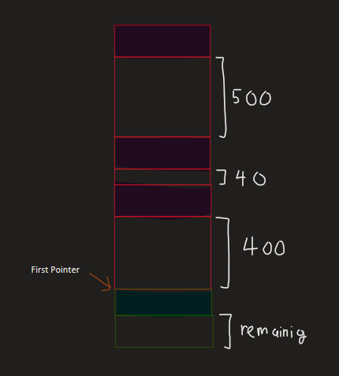</u>

**2. Freeing the 40 and 400 byte blocks**
```c
//Then free the memory of b and c
sfree(b);
sfree(c);
```
- We then free the 40 byte block, followed by the 400 byte block. As `sfree()` adds every freed block to the head of the free list, the block that was freed last ends up first.
- The first pointer (`list_head`) therefore points to the 400 byte block. Its `next` points backwards in memory to the 40 byte block, whose `next` points to the remaining block at the end of the heap.
- This shows that the order of the free list does not match the order of the blocks in memory. It depends on the order the blocks were freed in.

<u></u>

**3. Where the 40 byte request should go**
```c
//Finally ask for 40 bytes, which should fit perfectly
void  *d  =  smalloc(40);
```
- We then request 40 bytes. The recently freed 40 byte block fits this request exactly, so no memory would be wasted and the block would not need to be split.
- This is the block that the best-fit function chooses, as it is the smallest block that is big enough. The 400 byte block is left whole.

<u></u> 


**4. Where first-fit actually puts it**

- With first-fit, the search stops at the first node that is big enough, which is the 400 byte block of `list_head`. This means the 40 byte block is never checked.
- This results in the 400 byte block is split into a 40 byte allocated block and a 344 byte remainder (400 bytes, minus the 40 bytes requested, minus the 16 byte header of the remainder).
- **Important** - This means when we then request 400 bytes again, the request fails, as there is no contiguous block of memory with this size (Only 344, 40, or 20 bytes).

<u></u>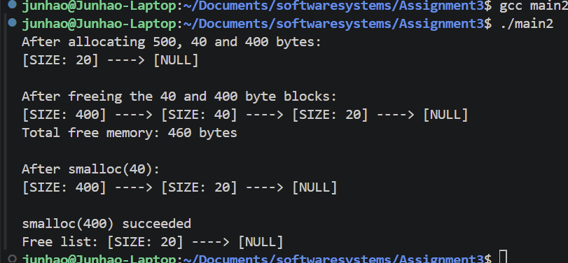

## find_best_listnode()

This function is used to go through the whole freelist and return the smallest node that is big enough for the request. It returns `NULL` if no node is big enough.

```c
// function for finding best node to create memory
common_header_t *find_best_listnode(int byte_count, common_header_t **previous_head)
{
    common_header_t *temp = list_head;
    common_header_t *temp_previous = NULL; // node before temp during the walk
    common_header_t *final = NULL;         // smallest node found that fits

    *previous_head = NULL;

    // go through the whole list, as a smaller fitting node could be anywhere
    while (temp != NULL)
    {
        // only consider nodes big enough for the request
        if (byte_count <= temp->size)
        {
            // first fitting node, or smaller than the best so far
            if (final == NULL || temp->size < final->size)
            {
                final = temp;
                *previous_head = temp_previous; // save the node before the best one
            }
        }

        temp_previous = temp;
        temp = temp->next;
    }

    return final; // NULL if no node fits
}

```
- The free list is walked from `list_head` using two temporary pointers. `temp` is the node currently being checked and `temp_previous` is the node before it.
- The actual pointers, `final` and `*previous_head`, hold pointers for the best node found so far and the node before it. These are the values given back to `smalloc`, and they only change when a better node is found.
- For every node, we first check that it is big enough for the request. We then check that it is better than the best node found so far, which is true if no node has been found yet (`final` is `NULL`) or if its `size` is smaller than the current best. If both checks pass, the temporary pointers are copied into the actual pointers. 
- If no node is big enough, `final` is never changed from `NULL`, which is returned so that `smalloc` knows the request cannot be satisfied. 

# Version 2.2 - Merging adjacent free blocks


The aim of this task was to change how freed blocks are returned to the free list. In Version 1, `insert_at_head()` was used to add the freed block to the start of the list, and free blocks were never joined back together. In this task we created two fundamental functions  `insert_in_order()` which keeps the free list sorted by memory address, and `merge()` which joins the freed block with other free blocks adjacent in memory.

Without merging when we deallocate memory lots of pieces of memory, the heap will be split into smaller and smaller blocks. This means a request to a large amount of memory from the heap could fail even if there is enough free memory in total, because the free memory is not in one contiguous block. Merging reduces this fragmentation by turning adjacent free blocks back into one larger block.

## Demonstrating the wastefullness caused by not merging or sorting list nodes


To demonstrate and explain the fragmentation caused by `insert_at_head()` we created a small test programme like before.

In the diagrams below, allocated blocks are shown in red and free blocks are shown in green. The shaded part at the top of each block is its header. The total memory size is **1024 bytes.**

**1. Allocating the blocks**

```c
// First fill the heap with three 200 byte blocks and a 300 byte block
void  *a  =  smalloc(200);
void  *b  =  smalloc(200);
void  *c  =  smalloc(200);
void  *d  =  smalloc(300);
```

- We first allocate three blocks of 200 bytes, followed by a block of 300 bytes. Each block is split from the single free block created at initialisation, so they are placed one after another in memory.
- Only a small remaining block of 44 bytes is left free at the end of the heap. This is the only node in the free list, so the pointer (`list_head`) points to it.

<u>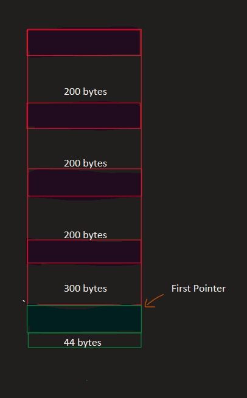</u>


**2. Freeing the first and third blocks**
```c
//Then free the memory of a and c, which are not next to each other
sfree(a);
sfree(c);
```
- We then free block `a` and then block `c`. As `insert_at_head()` adds every freed block to the start of the free list, the block that was freed last ends up first. The first pointer (`list_head`) therefore points to block `c`, whose `next` points backwards in memory to block `a`.
- This shows that the order of the free list does not match the order of the blocks in memory in address order. It depends on the order the blocks were freed in.

<u>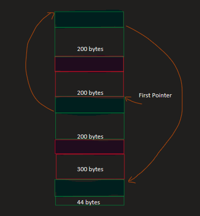</u>
 
**3. Freeing the block in between and requesting a large block**

```c
//We then free the memory of b which is in between a and c
sfree(b);

//Finally we ask for 500 bytes, which is bigger than any of the blocks that were freed
void  *e  =  smalloc(500);
```
- We then free block `b`, which is added to the start of the free list. The free list is now `b`, then `c`, then `a`, even though in memory the order is `a`, `b`, then `c`.
- Blocks `a`, `b` and `c` are now all free and directly next to each other in memory, but they stay as three separate 200 byte blocks, as they are never joined back together.
- This results in a total of 644 bytes of free memory, but the largest block is only 200 bytes.
- **Important** - This means when we then request 500 bytes, the request fails, as there is no contiguous block of memory with this size (Only 200, 200, 200, or 44 bytes).


<u>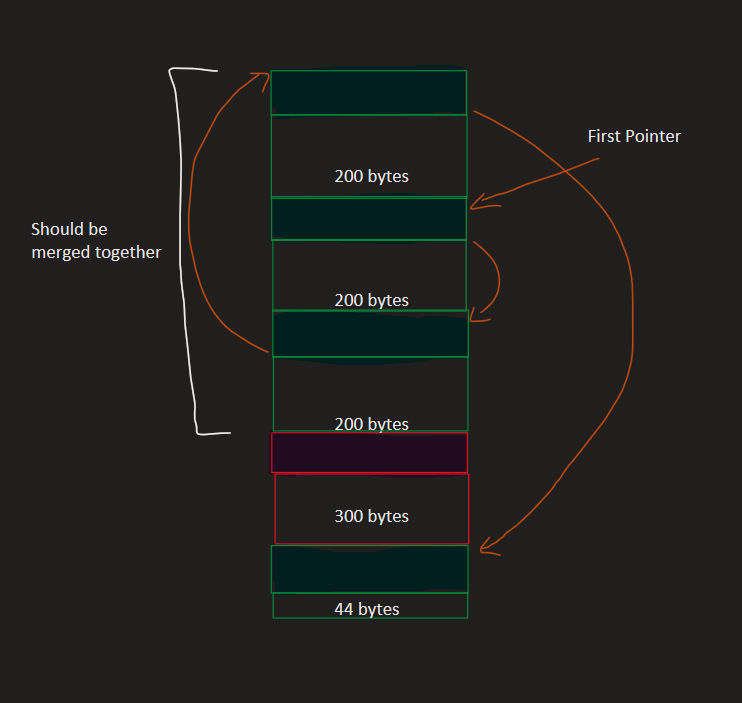</u>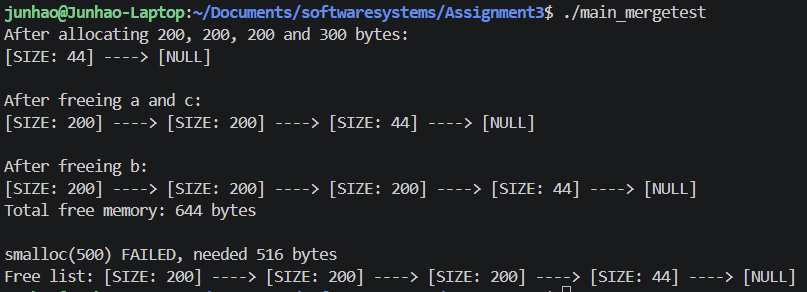
 
**4. What should happen**
 
- With `insert_in_order()`, freeing `a` and then `c` gives the free list `a`, then `c`, as `a` has the lower address. The order of the free list now matches the order of the blocks in memory.
- When `b` is freed, it is inserted in between `a` and `c`, which are both directly next to it in memory. `merge()` first joins `b` with the block after it, which is `c`. It then joins the block before it, which is `a`, with `b`. This leaves a single block of 632 bytes (200 bytes for each of the three blocks, plus the two 16 byte headers that are no longer needed).
- The 500 byte request now succeeds, as it is given part of the 632 byte block.
<u></u>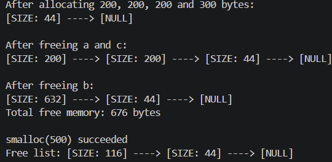

## Changes to sfree()
 
The only change to `sfree()` was replacing the call to `insert_at_head()` with `insert_in_order()` and `merge()`.
 
```c
void sfree(void *memptr)
{
    if (memptr == NULL)
    {
        return;
    }
 
    common_header_t* meta_head = (common_header_t*)((char*)memptr - sizeof(common_header_t));
 
    // This will insert the block into the list in address order
    common_header_t* previous = insert_in_order(meta_head);
 
    // This will join the block with any adjacent free blocks
    merge(meta_head, previous);
}
 
```
- The freed block is first inserted into the free list in address order. The node before it is also returned by the function
- `merge()` is then called with the arguements of the freed block and the previous node, so that any adjacent free blocks are joined together straight away.
 
## insert_in_order()
 
This function is used to insert a freed block into the free list so that the list stays sorted by address. It returns the node before the freed block, or `NULL` if the freed block is the first node.
 
```c
// function for inserting a freed block so the list stays sorted by address.
// function will also return the previous node
common_header_t *insert_in_order(common_header_t *node)
{
    //temporary pointers to nodes that will change as we itterate through the list
    common_header_t *temp = list_head;
    common_header_t *temp_previous = NULL;
 
    //When this while loop terminates the value of temp will be the first node with a higher address than the freed block
    while (temp != NULL && temp < node)
    {
        temp_previous = temp;
        temp = temp->next;
    }
 
    //Link node to next node
    node->next = temp;
 
    //Link node to previous node
    if (temp_previous == NULL)
    {
        list_head = node;
    }
    else
    {
        temp_previous->next = node;
    }
 
    return temp_previous;
}
 
```
The free list is walked from the `list_head` using the pointer `temp`, which points to the current node being examined, and `temp_previous`, which points to the node immediately before it.

- The `while` loop compares the address of the block being freed with the address of the current node. The loop stops when `temp` points to the first node with a higher memory address than the freed block. If the end of the list is reached, `temp` becomes `NULL`, meaning the freed block has the highest address and should be inserted at the end of the list.
- The freed block is then inserted between `temp_previous` and `temp`, so the list remains in ascending order of memory addresses. If `temp_previous` is `NULL`, the freed block has the lowest address, so `list_head` is updated to point to it.
- The function returns `temp_previous`, allowing the `merge()` function to check if the preceding free block is adjacent to the newly freed block without having to traverse the list again.

## merge()
 
This function is used to join a freed block with the free blocks on either side of it.
 
```c
void merge(common_header_t *node, common_header_t *previous)
{
    // Joins the freed block with the free block after it, which is node-> next
    merge_next(node);
    // Joins the free block before it with the freed block, which is previous -> next which is node.
    merge_next(previous);
}
 
```
- As the free list is sorted by address, the only blocks that can be next to the freed block in memory are the nodes directly before and after it in the free list. This means only two checks are needed, and the whole free list does not have to be searched.
- We first use `merge_next()` on the freed block, which joins it with the block after it. We then use `merge_next()` on the previous node, which joins it with the freed block.
- **Important** - The order of the function calls is importnat. If the previous node was merged first, the freed block would no longer be a node in the free list, so it could not be joined with the block after it.

## `merge_next()`

This function merges a free-list node and the node after it, if the two blocks are physically next to each other in memory. This combines them into a single, larger free block capable of storing a larger block of memory.
 
```c
// function for joining two adjacent nodes
void merge_next(common_header_t *node)
{
    if (node == NULL || node->next == NULL)
    {
        return;
    }
 
    //Pointer arithmetic to calculate the address just after the end of the node
    common_header_t *test_node_bottom = (common_header_t *)((char *)node + sizeof(common_header_t) + node->size);
 
    //We then test if they are equal
    if (test_node_bottom == node->next)
    {
        node->size += node->next->size + (int)sizeof(common_header_t);
        node->next = node->next->next;
    }
}
 
```
- If the node is `NULL`, or there is no node after it, there is nothing to join, so the function simply returns.
- We calculated the address just after the end of the node using pointer arithmetic. As in `split_node()`, we first cast the pointer to `char *` so that the pointer arithmetic moves in single bytes.
- If this address is equal to the address of the next node, the two blocks are directly next to each other in memory, with no allocated block in between.
- The node then takes over the next node. We add the next node's `size` and the size of its header to the node's `size`, as the header is no longer needed and becomes part of the data. We then set `next` to the node after the next node, which removes the next node from the free list.

# Stress Testing All Versions


In this task we tested our allocator with a much bigger load than the small test programmes we used before. We used the `stress_test.c` programme given in the assignment and set `MEM_SIZE` to 10 MB.

The stress test makes 50,000 requests, each between 1 byte and 32 KB. It keeps up to 512 blocks allocated at once (`LIVE`), and every 128 requests it frees a random block so that gaps appear in the heap. It then reports how many requests worked, when the first one failed, how long the free list got and how fragmented the free memory was.

We ran it on three versions of our allocator, changing `smalloc()` and `sfree()` by hand between each run:

- **4.1** First-fit, no merging 
- **4.2** Best-fit, no merging
- **4.3** Best-fit, with merging 

After that we increased the load on Version 2 to see when it would start failing too.


## Summary of results

All three runs used `LIVE` = 512.

| | 4.1 First-fit, no merge | 4.2 Best-fit, no merge | 4.3 Best-fit, merge |
|---|---|---|---|
| Successful requests | 21.33% | 78.68% | 100.00% |
| Successful allocation (bytes) | 6.37% | 62.44% | 100.00% |
| Requests before first failure | 866 | 2666 | No failure |
| Free memory at first failure | 2.00 MB | 2.40 MB | No failure |
| Request size at first failure | 29 KB | 31 KB | No failure |
| Memory utilisation at first failure | 0.80 | 0.76 | No failure |
| Bytes-to-failure turnover (BTF) | 1.30 x `MEM_SIZE` | 3.98 x `MEM_SIZE` | No failure |
| Final / maximum free list length | 7458 / 7458 | 2704 / 2705 | 75 / 90 |
| Final / maximum external fragmentation | 0.9996 / 0.9996 | 0.9960 / 0.9964 | 0.2931 / 0.4759 |

## 1 - First-fit, no merging

<u>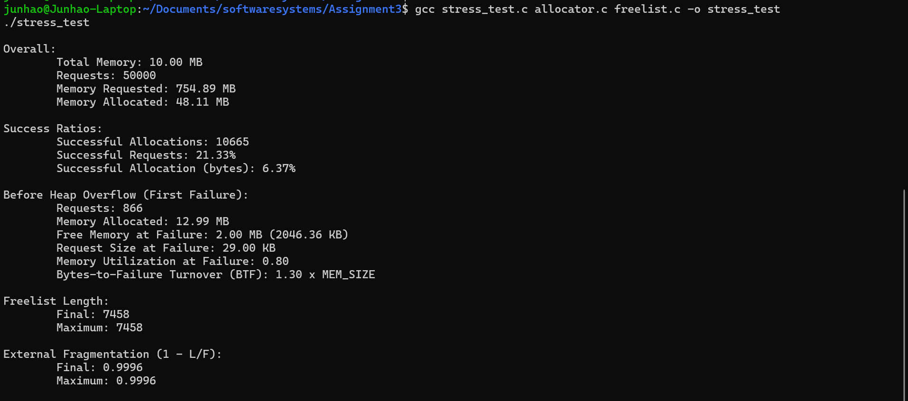</u>

- This version did pretty badly. The first failure came after only 866 requests, and overall only 21.33% of requests worked.
- When it failed there was still 2.00 MB of total memory in the heap, but it couldn't find space for a 29 KB request. The free memory had been split into 7458 small blocks, and the fragmentation was 0.9996, so the biggest free block was tiny compared to the total.
- This is because freed blocks just go to the head of the list and never get joined back together, so the heap only gets divided when something is freed. First-fit also makes it worse because it cuts into the first big block it finds, even for small requests.
- Only 6.37% of the bytes requested were allocated, which is a lot lower than the 21.33% of requests. This is because the requests that still worked were mostly the small ones that could fit into the leftover gaps, while nearly all the big ones failed.

## 2 - Best-fit, no merging

<u>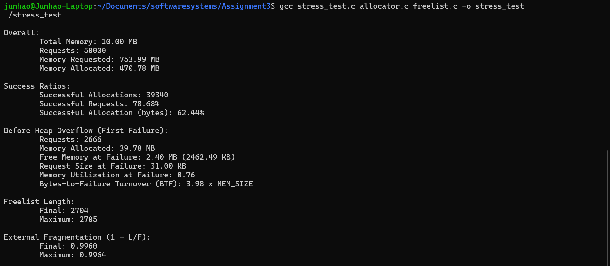</u>

- Using best-fit worked a lot better. It lasted around three times as long before its first failure (2666 requests instead of 866), and its BTF was 3.98 compared to 1.30. Overall 78.68% of requests worked.
- This is because best-fit picks the smallest block that fits, so the bigger blocks are kept for bigger requests instead of being cut up.
- The free list was also shorter, at 2704 blocks instead of 7458. Since best-fit usually picks a block close to the size asked for, there's often little or nothing left over to split off.
- It still failed with 2.40 MB free though, and the fragmentation was still about 0.996. So without merging, best-fit only slows the fragmentation down, it doesn't stop it.

## 3 - Best-fit, with merging

<u>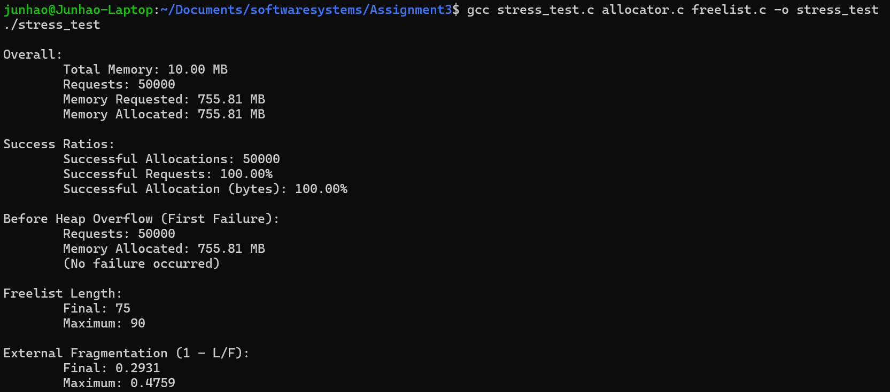</u>

- With merging, all 50,000 requests worked. It got through 755.81 MB of requests with only a 10 MB heap, which is around 75 times the heap size, and never failed once.
- The free list never went above 90 blocks, compared to thousands in the other two versions. This is because every time a block is freed next to another free block, they get joined back into one bigger block.
- The fragmentation stayed under 0.5 the whole time and ended at 0.2931, meaning the smallest free contiguous memory was at least half the total memory available at that point. This means there was always a big enough free block for the large requests.


## Finding the tipping point

Since best-fit with merging didn't fail at all with `LIVE` = 512, we kept increasing `LIVE` to see where it would start failing. `LIVE` is how many blocks the stress test keeps allocated at once, so a higher `LIVE` means more of the heap is being used at the same time.

<u>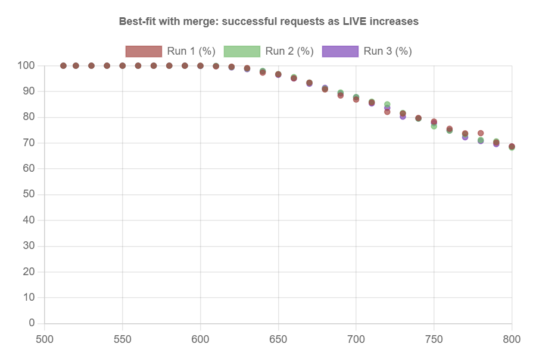</u>

- Up to `LIVE` = 580, every request worked in all three runs.
- At `LIVE` = 590 one of the three runs had a failure, and from 600 onwards every run failed at some point. So we took the tipping point to be around 590 to 600.
- After that the success rate drops pretty steadily, down to about 68% at `LIVE` = 800. The three runs are almost on top of each other on the graph, so the results were quite consistent.

We think the tipping point makes sense when you look at the heap size. Requests are between 1 byte and 32 KB, so the average is about 16 KB, plus the 16 byte header. That means a 10 MB heap can hold roughly 10 MB / 16 KB ≈ 639 average-sized blocks at once. It starts failing a bit before that, probably because some requests are bigger than average and there's always some space wasted in gaps between blocks.

**Important** - With merging, the allocator only started failing once the heap was almost full (the memory utilisation at the first failure was 0.95 or more). This means that fragmentation was not an issue.

## allocator_stats()

The stress test needed a function called `allocator_stats()` in the allocator module. It gives back the number of free blocks (`N`), the total free memory (`F`) and the size of the largest free block (`L`).

```c
// function used by the stress test to find the number of free blocks (N),
// the total free memory (F) and the largest free block (L)
void allocator_stats(size_t *N, size_t *F, size_t *L)
{
    freelist_stats(N, F, L);
}
```

- The assignment said the allocator module should use the free list module, so `allocator_stats()` just calls `freelist_stats()` in `freelist.c` instead of going through the list itself.
- We pass the three values by reference, since a function can only return one value.

## freelist_stats()

This function goes through the free list and works out the three values for `allocator_stats()`.

```c
// function for calculating the number of free blocks, total free memory and largest free block
void freelist_stats(size_t *N, size_t *F, size_t *L)
{
    *N = 0;
    *F = 0;
    *L = 0;
    common_header_t *temp = list_head;

    while (temp != NULL)
    {
        *N += 1;
        *F += temp->size;

        if ((size_t)temp->size > *L)
        {
            *L = temp->size;
        }
        temp = temp->next;
    }
}
```

- We start all three values at 0, then go through the list from `list_head`.
- For each node we add 1 to the count, add its `size` to the total, and if it's bigger than the largest block so far it becomes the new largest.
- `size` doesn't include the header, so `F` and `L` only count space that can actually hold data.
- The stress test uses these to work out the external fragmentation, `1 - L/F`. If all the free memory is one big block then `L = F` and the fragmentation is 0. If it's split into lots of small pieces, `L` is tiny compared to `F` and the fragmentation gets close to 1.


# Version 3 - Size-class arenas


The aim of this task was to split our single heap into three separate regions of memory, called arenas. Previously, every allocation, no matter the size, was taken from the same 10 MB heap and tracked in the same free list. In this task we created three arenas, each obtained from its own `mmap()` call and each with its own free list. Every request is sent to one arena depending on its size, and we kept best-fit and merging from Version 2 inside each arena.

| Arena | Request size (including the header) | Arena size |
|---|---|---|
| TINY | up to 256 bytes | 1 MB |
| SMALL | 257 bytes to 8 KB | 3 MB |
| MEDIUM | above 8 KB | 6 MB |


The main problem with a single heap is that all allocations compete for the same area of memory. Small, frequent allocations end up scattered in between large ones, which can stop large free blocks from being merged back together, and every request has to search through one long free list containing blocks of every size. Arenas separate the memory into independent regions, so that small allocations cannot interfere with the management of larger ones.


## Demonstrating the problems with a single heap

To explain why arenas are useful, we will go through the problems that happen when every allocation shares one heap.

In the diagrams below, allocated blocks are shown in red and free blocks are shown in green. The shaded part at the top of each block is its header. The total memory size is **10 MB.**


**1. Small allocations stop large blocks from merging**

```c
//Allocate a large block followed by a tiny block
while (pairs < MAX_PAIRS)
{
    large[pairs] = smalloc(20000);
    if (large[pairs] == NULL)
    {
        break;
    }
    tiny[pairs] = smalloc(100);
    pairs++;
}

//Free all the large blocks
for (int i = 0; i < pairs; i++)
{
    sfree(large[i]);
}

//Ask for 40000 bytes, which is bigger than one of the freed large blocks
void *big = smalloc(40000);
```

- To demonstrate this, I created a small test programme, `main_arenatest.c`. It keeps allocating a 20,000 byte block and then a 100 byte block, until there is no space left.
- In a single heap, the blocks are placed one after another in memory, so every tiny block ends up directly in between two large blocks.
- We then free every large block, but keep all of the tiny blocks allocated.
- Even though the free list is sorted and merging is used, the freed large blocks cannot be joined together. This is because there is a tiny block still allocated in between each of them, so no two free blocks are directly next to each other in memory.
- This leaves a total amount of 10MB available in the heap memory, but only 20000 bytes is contiguous - **This is external fragmentation,**


<u>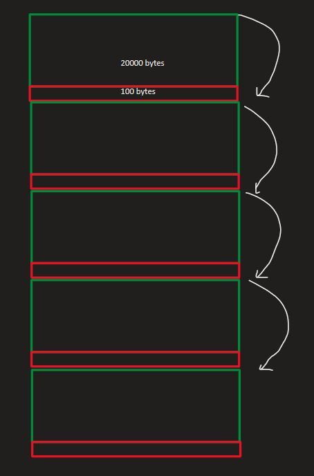</u>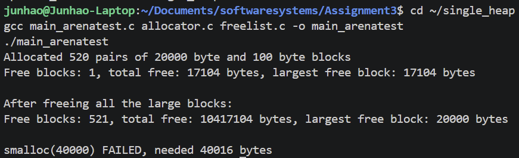

**2. Inefficient Searching for a Free Block**

- Also with one heap everytime you allocate memory you must search the same free list, no matter its size. Imagine the free list contains 10000 blocks of 32 bytes, and 20 blocks of 100 KB.
- If we request 80 KB, `find_best_listnode()` has to go through all 100100 nodes to be sure it has found the smallest block that fits, even though most of the blocks are far too small for the request.
- The more small and large blocks there are mixed together in the free list, the longer every request takes, as best-fit always has to check every node.


<u>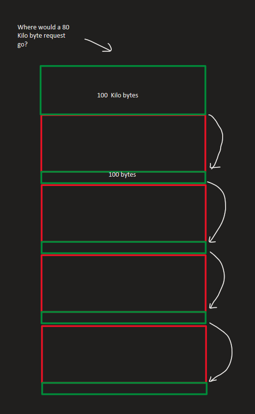</u>


## The arena structure

This structure is used to store the information about each arena. We created an array of three of them, one for each arena.

```c
// structure for storing information about each arena
// stores the first address of the arena(this will NOT change), the size of the arena in bytes 
// and the first node of the arena's freelist(this will change).
typedef struct
{
    char *start;           
    size_t size;          
    common_header_t *head; 
} arena_t;

// index 0 is tiny, 1 is small and 2 is medium
arena_t arenas[NUM_ARENAS];
//0 if arenas are created 1 if they are not
int arenas_created = 0;
```

- `start` stores the first address of the arena and `size` stores how big it is. These never change after the arena is created, and are used later to work out which arena a freed block belongs to.
- `head` points to the first node of that arena's free list. This changes every time the start of the free list changes
- `arenas_created` makes sure the arenas are only created once. Before, we checked if `list_head` was `NULL`, but this is also true when the heap is completely full, a bug fixed now which would have caused `mmap()` to be called again to create another heap.
- All our free list functions work on `list_head`, so rather than rewriting them, we just point `list_head` at the right arena's free list before calling them, then save it back into the arena after. This meant we could reuse all our free list functions from before.

<u>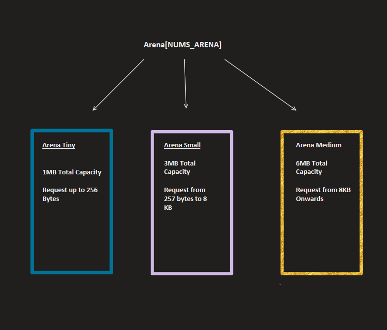</u>

## create_arenas()

This function is used to create the three arenas the first time `smalloc()` is called. It returns 1 if all three were created, and 0 if `mmap()` failed.

```c
// function for creating the three arenas, each with its own freelist
// returns 1 if all three were created and 0 if mmap failed
int create_arenas(void)
{
    size_t arena_sizes[NUM_ARENAS] = {TINY_SIZE, SMALL_SIZE, MEDIUM_SIZE};

    for (int i = 0; i < NUM_ARENAS; i++)
    {
        //creates memory space for each arena with respective size
        void *temp = get_mem_block(NULL, arena_sizes[i]);

        if (temp == NULL)
        {
            //returns 0 so function that called it knows it has failed
            return 0;
        }

        //initialises the memory space as a list_head
        init_free_list(temp, arena_sizes[i]);

        //list_head is not global now it is specific to that arena
        arenas[i].start = (char *)temp;
        arenas[i].size = arena_sizes[i];
        arenas[i].head = list_head;
    }

    return 1;
}
```

- For each arena, we use `get_mem_block()` to request a chunk of memory from the operating system, so each arena is its own separate memory region.
- `init_free_list()` then turns this memory into a free list with a single node like before however, we must copy `list_head` into the arena's `head` afterwards as there are multiple `list_head's`.
- We also save the starting address and size of the arena, so that `find_arena()` can use them later.

## choose_arena()

This function is simple and is used to decide which arena a request should go into. It returns 0 for tiny, 1 for small and 2 for medium.

```c
// function for choosing which arena a request goes into
int choose_arena(int byte_count)
{
    int total_size = byte_count + (int)sizeof(common_header_t);

    if (total_size <= TINY_MAX)
    {
        return 0;
    }
    else if (total_size <= SMALL_MAX)
    {
        return 1;
    }
    else
    {
        return 2;
    }
}
```

- The request size includes the header, so we add the header size to the request first.
- We then check which arena it fits into, starting with the smallest.


## find_arena()

This function is used by `sfree()` to work out which arena a block came from. It returns -1 if the address is not inside any of the arenas.

```c
// function for finding which arena a block belongs to, using its address
// returns -1 if the address is not inside any of the arenas
int find_arena(void *ptr)
{
    char *address = (char *)ptr;

    for (int i = 0; i < NUM_ARENAS; i++)
    {
        // the block is in this arena if its address is between the start and the end of the arena
        if (address >= arenas[i].start && address < arenas[i].start + arenas[i].size)
        {
            return i;
        }
    }
    return -1;
}
```

- `sfree()` is only given a pointer, so it does not know which arena the block was allocated from.
- Each arena is one contiguous block of memory, so we check if the address lies between the start and the end of each arena.
- We cast the pointer to `char *` so that `start + size` moves in single bytes


## Changes to smalloc()

```c
void *smalloc(int byte_count)
{
    // the arenas on the first memory allocation call
    if (!arenas_created)
    {
        if (!create_arenas())
        {
            return NULL;
        }
        arenas_created = 1;
    }
    int zone = choose_arena(byte_count);

    // The freelist functions all use list_head, so we point it at this arena's freelist
    list_head = arenas[zone].head;

    common_header_t *previous_head = NULL;
    common_header_t *current_head = find_best_listnode(byte_count, &previous_head);

    // statement is true if no suitable node has been found
    if (current_head == NULL)
    {
        return NULL;
    }

    common_header_t *replacement = split_node(current_head, byte_count);

    link_previous_node(previous_head, replacement);
    //updates list_head in case it has changed
    arenas[zone].head = list_head;

    // This gives address to the first memory location via pointer arithmetic
    // If you didnt convert curret_head pointer to type char it would move 16x16 memory
    return (char *)current_head + sizeof(common_header_t);
}
```

The function still follows the three steps given in the assignment:

-   **STEP 1.** On the first call, we use `create_arenas()` to create the three arenas instead of one heap. If it fails, the function returns `NULL`.
-   **STEP 2.** We use `choose_arena()` to pick the arena for the request, and point `list_head` at that arena's free list. We then use `find_best_listnode()` to find the smallest block that fits, the same as Version 2, but only within that arena.
-   **STEP 3.** If no block is big enough, `NULL` is returned. Otherwise `split_node()` splits the block and `link_previous_node()` connects the previous node to the remainder, the same as before.

Finally, we save `list_head` back into the arena, because `link_previous_node()` changes `list_head` if the first node of the list was used.

## Changes to sfree()

```c
void sfree(void *memptr)
{
    if (memptr == NULL)
    {
        return;
    }

    common_header_t *meta_head = (common_header_t *)((char *)memptr - sizeof(common_header_t));

    // The block has to go back into the freelist of the arena it came from
    int zone = find_arena(meta_head);
    if (zone == -1)
    {
        return;
    }
    list_head = arenas[zone].head;

    // This will insert the block into the list in address order
    common_header_t *previous = insert_in_order(meta_head);

    // This will join the block with any adjacent free blocks
    merge(meta_head, previous);
    //Updates list head in case it has changed
    arenas[zone].head = list_head;
}
```

-   We use `find_arena()` to find which arena the block came from, and point `list_head` at that arena's free list.
-   If the address is not inside any arena, the pointer was not given out by `smalloc()`, so the function simply returns.
-   The block is then inserted and merged the same as in Version 2. As each arena is a separate `mmap()` region, a block can only ever be merged with other blocks in its own arena.
-   Finally, we save `list_head` back into the arena, as `insert_in_order()` changes it if the freed block has the lowest address.

## allocator_list_dump()

We updated this function to print the free list of every arena.

```c
//this function allows us to visualise the block of the free memory list
void allocator_list_dump(void)
{
    char *names[NUM_ARENAS] = {"TINY", "SMALL", "MEDIUM"};
    // prints the freelist of each arena on its own line
    for (int i = 0; i < NUM_ARENAS; i++)
    {
        printf("%s: ", names[i]);
        common_header_t *temp = arenas[i].head;
        while (temp != NULL)
        {
            printf("[SIZE: %d] ----> ", (temp->size));
            temp = temp->next;
        }
        printf("[NULL]\n");
    }
}
```

-   As there are now three free lists, the function goes through each arena and prints its free list on its own line, with the name of the arena in front.

## allocator_free_mem_size()

```c
size_t allocator_free_mem_size(void)
{
    size_t N, F, L;
    allocator_stats(&N, &F, &L);
    return F;
}
```

-   The free memory is now spread across three free lists, so instead of going through `list_head`, this function uses `allocator_stats()` and returns `F`, the total free memory in all three arenas.

## allocator_zone_stats()

This function is used to find the number of free blocks, the total free memory and the largest free block in a single arena.

```c
// function used by the stress test to find the stats of one arena
// zone 0 is tiny, 1 is small and 2 is medium
void allocator_zone_stats(int zone, size_t *N, size_t *F, size_t *L)
{
    list_head = arenas[zone].head;
    freelist_stats(N, F, L);
}
```

-   The assignment asked for the results of each arena as well as overall, so we created this function, which points `list_head` at one arena's free list and then uses `freelist_stats()` from the stress testing section.
-   This changes `list_head`, but this does not cause a problem, as `smalloc()` and `sfree()` always point `list_head` at the correct arena before using it.

## allocator_stats()

We updated this function to find the overall results across all three arenas.

```c
// function used by the stress test to find the number of free blocks (N),
// the total free memory (F) and the largest free block (L) across all three arenas
void allocator_stats(size_t *N, size_t *F, size_t *L)
{
    *N = 0;
    *F = 0;
    *L = 0;

    for (int i = 0; i < NUM_ARENAS; i++)
    {
        size_t zone_N, zone_F, zone_L;
        allocator_zone_stats(i, &zone_N, &zone_F, &zone_L);
        *N += zone_N;
        *F += zone_F;

        //the largest free block is the largest of the three arenas
        if (zone_L > *L)
        {
            *L = zone_L;
        }
    }
}
```

-   The number of free blocks and the free memory from each arena are added together.
-   The largest free block is the largest of the three arenas' largest blocks. This means the overall fragmentation `1 - L/F` uses the combined `L` and `F`, as the assignment asked for.


## Stress testing the arenas

The original stress test only prints the overall results, so we made a copy called `stress_test_arenas.c` that also prints the results for each arena. We kept `MEM_SIZE` as 10 MB (the three arenas added together), so the results could be compared fairly with our single heap from 4.3.

<u>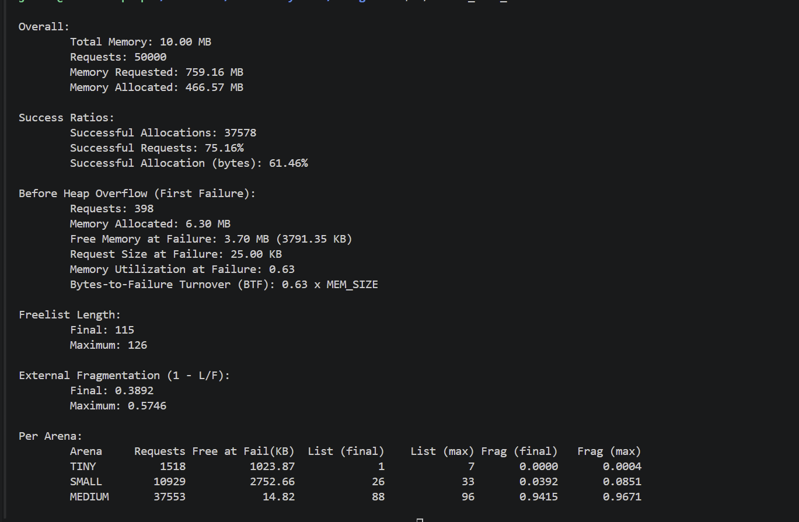</u>

| | 4.3 Single heap | Arenas |
|---|---|---|
| Successful requests | 100.00% | 75.16% |
| Successful allocation (bytes) | 100.00% | 61.46% |
| Requests before first failure | No failure | 398 |
| Free memory at first failure | No failure | 3.70 MB |
| Memory utilisation at first failure | No failure | 0.63 |
| Final / maximum external fragmentation | 0.2931 / 0.4759 | 0.3892 / 0.5746 |

| Arena | Requests | Free at first failure | Final / maximum free list length | Final / maximum fragmentation |
|---|---|---|---|---|
| TINY | 1518 | 1023.87 KB | 1 / 7 | 0.0000 / 0.0004 |
| SMALL | 10929 | 2752.66 KB | 26 / 33 | 0.0392 / 0.0851 |
| MEDIUM | 37553 | 14.82 KB | 88 / 96 | 0.9415 / 0.9671 |

**Why the arenas did worse overall**

- The arenas only managed 75.16% of requests, compared to 100% with the single heap, and the first failure came after just 398 requests.
- When it failed, there was still 3.70 MB free, and the memory utilisation was only 0.63. So over a third of the memory was free, but the allocator still couldn't fit a 25 KB request.
- The byte success rate (61.46%) is lower than the request success rate (75.16%). This is because nearly all the failed requests were the large ones, while the small ones still worked.

**Why the medium arena ran out**

- The stress test picks request sizes evenly between 1 byte and 32 KB, so about 75% of requests are above 8 KB. In our run, 37,553 of the 50,000 requests went to the medium arena.
- The stress test keeps 512 blocks allocated at once, so about 384 of them are medium blocks at any time. These average around 20 KB, so the medium arena needs about 7.5 MB to hold them, but it only has 6 MB.
- This is why the medium arena had only 14.82 KB left at the first failure.

**Why the tiny and small arenas were wasted**

- Only 1518 requests were small enough for the tiny arena, so almost all of its 1 MB was still free at the first failure.
- The small arena had about 2.7 MB of its 3 MB still free.
- That's about 3.7 MB of free memory which a large request couldn't use, because `choose_arena()` only ever sends large requests to the medium arena. In the single heap, any request could use any part of the 10 MB, which is why it never failed.

**What the fragmentation shows**

- The overall fragmentation (0.3892) is a bit higher than the single heap (0.2931). This is because `L` is the largest free block from any arena, and as the medium arena was full, the largest free block was in the small arena, which can't be used by large requests anyway.
- Inside the tiny and small arenas, the fragmentation stayed close to 0 and the free lists were very short (1 and 26 blocks). Requests in each arena were a similar size, so freed blocks merged back together easily.
- The medium arena's fragmentation was high (0.9415), but this was mostly because it was nearly full. The little space it had left was in small gaps between allocated blocks, so the largest free block was tiny compared to its total free memory.

<!-- DIAGRAM: three arena columns at the first failure. TINY almost all green, SMALL mostly green, MEDIUM almost all red. Label the 3.7 MB of unused free memory in TINY and SMALL. -->
<u></u>

**Important** - The arenas didn't fail because of fragmentation. Inside each arena, merging still worked well. They failed because the arena sizes don't match the request sizes in the stress test, so one arena ran out while the others had plenty of space. Arenas only help when the mix of requests matches the arena sizes.