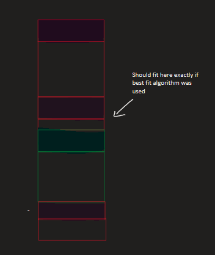
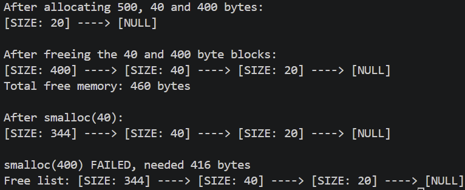
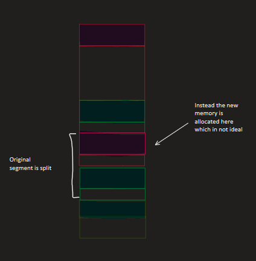

# Task 1/2 – Implement and Test Version 1

The aim of this task was to build our own versions of `malloc` and `free`, called `smalloc` and `sfree`, to virtually dynamically allocate and deallocate memory on the heap.

Our allocator works by intially requesting one large contiguous block of virtual memory from the operating system using `mmap()`. Each subsequent call to `smalloc()` allocates a sub-block from this region, with the size determined by the number of bytes requested by the caller. As memory is constantly allocated and deallocated, the original region becomes divided into allocated and free sub-blocks of different sizes, meaning the free memory is not one contiguous block but is `fragmented`. To keep track of available memory, we use the data structure `free list`, which is a linked list storing information about each sub-block such as it's memory address, and the size of free memory available.

When `smalloc()` is called, the allocator searches the free list for a block large enough, and if a block is found, it can be split, giving a portion to the caller and any remaining space to the linked list. Similarly, when `sfree()` is called, the previously allocated block is returned to the free list so that it can be reused by future allocation requests. 

Adjacent free blocks can also be merged together to form larger free regions, helping to reduce memory fragmentation.

Note: As an extension, we only split a free block if the leftover part was big enough to be useful.

## get_mem_block()

This function is used to request one large block of memory from the operating system.

```c
void *get_mem_block(void *addr, size_t mem_size)
{
    void *h_ptr = mmap(
        addr,                        // starting address hint (NULL lets kernel choose)
        mem_size,                    // number of bytes requested
        PROT_READ | PROT_WRITE,      // memory should be readable and writable
        MAP_PRIVATE | MAP_ANONYMOUS, // private mapping, not backed by a file
        -1,                          // no file descriptor needed
        0                            // offset must be zero for MAP_ANONYMOUS
    );

    if (h_ptr == MAP_FAILED)
    {
        return NULL; // return NULL if mmap fails
    }
    return h_ptr; // otherwise return the allocated memory
}

```

-   We used `mmap()`, a system call that maps a new region of memory into the process's address space. It is normally used to map files into memory, but we used the `MAP_ANONYMOUS` flag so the memory was not backed by any file, which gave us a block of uninitialised memory.
-   We passed `NULL` as the address so the kernel could choose the starting address for the memory
-   We used `PROT_READ | PROT_WRITE` so the program could read and write the memory, and `MAP_PRIVATE` so the memory belonged only to this process.
-   Because no file was used, we set the file descriptor to `-1` and the offset to `0`.

## init_free_list()

This function is used at initialisation to turn the large block from `get_mem_block()` into a freelist with a single node, representing the whole block of free memory.

```c
void init_free_list(void *mem, size_t mem_size)
{
    //converts the starting memory from type void to type common_header 
    list_head = (common_header_t *)mem;
    list_head->size = (int)(mem_size - sizeof(common_header_t));
    list_head->next = NULL;
}

```
-   Every block of memory, free or allocated, begins with a `common_header_t` header. It stores the number of bytes of data the block could hold and, a pointer to the next node of the freelist.
-   The assignment stated that the header took up 8 bytes, as the pointer and integer variable within the struct both have a width of 4 bytes. This is only true on a typical 32-bit system, as on a 64-bit system the pointer takes up 8 bytes, int takes up 4 bytes and an additional 4 bytes of padding, bringing the total header size to 16 bytes. To account for this difference, we used `sizeof(common_header_t)` throughout the code, so our allocator could work across both 32-bit and 64-bit systems.
-   We converted the start of the block from `void *` to `common_header_t *`, so its first bytes could be used as a header.
-   We set `size` to the whole block minus the header, because `size` only counts for the bytes available for data.
-   We set `next` to `NULL`, because at the start there is only one free block.


## free_list_is_empty()

This function is used to check if the freelist has any nodes. It returns 1 if `list_head` is `NULL` and 0 otherwise.

```c
int free_list_is_empty(void)
{
    return list_head == NULL;
}
```

-   `smalloc` uses this to check if the heap has been created yet, without reading `list_head` itself.

## smalloc()

This function is used to find a free block that has enough memory for the caller. It then splits that block, and returns a pointer to the memory the program can use.

```c
void *smalloc(int byte_count)
{
    if (free_list_is_empty())
    {
        void *temp = get_mem_block(NULL, MEM_SIZE);
        if (temp == NULL)
        {
            return NULL;
        }
        init_free_list(temp, MEM_SIZE);
    }
    common_header_t *previous_head = NULL;
    common_header_t *current_head = find_first_listnode(byte_count, &previous_head);

    if (current_head == NULL)
    {
        return NULL;
    }
    common_header_t *replacement = split_node(current_head, byte_count);
    link_previous_node(previous_head, replacement);

    // This gives address to the first memory location via pointer arithmetic
    return (char *)current_head + sizeof(common_header_t);
}
```
The function follows the three steps given in the assignment:

-   **STEP 1.** We first check if the freelist is empty meaning the virtual heap has not been created yet. Therefore we use the `get_mem_block()` to get `MEM_SIZE` bytes from the operating system, and `init_free_list()` to turn it into a freelist. If it fails then the function will return `NULL.`
-   **STEP 2.** We use the function`find_first_listnode()` to locate the first free block in the free list that is big enough for the request. This function also gives back the node before it in `previous_head`.
-   **STEP 3.** If there isn't a block that is big enough, `NULL` will be returned. Otherwise the `split_node()` is called to split the block into an allocated block and a remainder, and `link_previous_node()` to connect the previous node to the remainder.

Finally, a pointer to the memory just after the header is returned. The program using `smalloc` will only ever see the data part of the block, and never the header.

## find_first_listnode()

This function is used to go through the freelist and return the first node that is big enough for the request. It returns `NULL` if no node is big enough.

```c
common_header_t *find_first_listnode(int byte_count, common_header_t **previous_head)
{
    //We must keep track of both the current and previous head
    common_header_t *current_head = list_head;
    *previous_head = NULL;
    //This while loop traverses the memory searching for the first freelist node that can store the byte size
    while (current_head != NULL)
    {
        if (byte_count <= (current_head->size))
        {
            break;
        }
        *previous_head = current_head;
        current_head = current_head->next;
    }
    return current_head;
}
```

-   The freelist is walked from `list_head`, one node at a time. As soon as a node whose `size`  is big enough, that node's pointer value is returned. This is **first-fit**, as the first block that fits is chosen, even if a better sized block exists somewhere else on the list. If the end of the list is reached without finding a node, `current_head` is `NULL`, which is returned.
- We also needed to keep track of the node before the chosen node because the free list is a singly linked list, meaning each node only contains a pointer to the next node. When we split a free block, we create a new header for the remaining free sub-block. We then need to update the previous node's `next` pointer so that it points to this new sub-block. Since we cannot move backwards through the list, we tracked the previous node as we searched through the free list.
-   A function can only return one value, so we gave back the previous node by passing by reference through`previous_head`, which is a pointer to a pointer. The function also writes the previous node into it.
-   If the chosen node is the first node of the list, `previous_head` stays `NULL`.

## split_node()

This function is used to split the chosen free block into an allocated block and a free remainder. 
```c
common_header_t *split_node(common_header_t *current_head, int byte_count)
{
    //This calculates contiguous bytes of data of the new freelist node
    int remainder_size = current_head->size - byte_count - (int)sizeof(common_header_t);
    //This so we can link the new freelist node witht the next freelist node
    common_header_t *replacement = current_head->next;

    //This is a feature added so that if the size of the freelist node is less than a certain value(8)
    //that malloc function call will occupy additional unneeded bytes.
    if (remainder_size >= (int)sizeof(current_head))
    {
        //Pointer arithmetic to calculate the pointer value for the new freelist node
        //Moves towards higher memory addresses within the allocated memory region.
        common_header_t *remainder = (common_header_t *)((char *)current_head + sizeof(common_header_t) + byte_count);

        //Information about the new freelist node is updated
        remainder->size = remainder_size;
        remainder->next = current_head->next;
        //Pointer is copied so it will exist outside of if statement
        replacement = remainder;

        //current_head becomes new metadata header
        current_head->size = byte_count;  
        current_head->next = NULL;  
    }
    // otherwise keep current_head->size
    else{
        current_head->next = NULL;
    }
    return replacement;
}
```

First, we calculated the size of the remaining free space. Since the remainder needs its own header, we subtract the requested bytes and the size of the header from the original block's size.

- We initially set `replacement` to the node after the chosen block. This is so that if the block is not split, we can simply link the previous node to the next node in the list.

**If the remainder is large enough, we split the block**:
1. We calculated the address of the remaining free block using pointer arithmetic. We first cast the pointer to `char *` because pointer arithmetic moves by the size of the data type being pointed to. Adding 1 to a `common_header_t *` moves by the size of the struct, whereas adding 1 to a `char *` moves by just 1 byte. This allows us to find the exact address of where the remaining free block starts.
2. We set the remainder's `size` and its `next` pointer. Its `next` points to the node after the original block, so the new remainder takes its place in the free list.
3. We then update the chosen block's header to represent the allocated block. We set its `size` to `byte_count`, so that `sfree()` knows how much memory to return later. We also set `next` to `NULL`, as allocated blocks are no part of the free list.

**Important**  -If the remainder is less than 8 bytes (on a 32-bit system), we don't split the block. This is because 8 bytes is the minimum size needed to store a header, so there would not be enough space to create another free list node. Instead, we give the entire block to the caller, including the remaining unused bytes, and keep its original `size` so that `sfree()` can return the whole block to the free list.

## link_previous_node()

This function updates the previous node's `next` pointer to point to the replacement node, removing the chosen block from the free list.
```c
void link_previous_node(common_header_t *previous_head, common_header_t *replacement)
{
    //links previous node to new node
    if (previous_head == NULL)
    {
        list_head = replacement;
    }
    else
    {
        previous_head->next = replacement;
    }
}
```

-   If `previous_head` is `NULL`, the chosen block is the first node of the list. Nothing points to it except `list_head`, so we changed `list_head` itself to point to the replacement.
-   Otherwise, we changed the previous node's `next` to point to the replacement.
-   The function will work when it creates a remainder (if the block was split) or the node after the chosen block (if it was not).

## sfree()

We used this function to give an allocated block back to the freelist.

```c
void sfree(void *memptr)
{
    if (memptr == NULL)
    {
        return;
    }
    common_header_t *meta_head =
    (common_header_t *)((char *)memptr - sizeof(common_header_t));
    // This will insert the block at the head of the freelist
    insert_at_head(meta_head);
}
```

-   If `memptr` is `NULL`, there is nothing to free, so the function simply returns. This is the same behaviour as the standard `free()`.
-   The pointer passed to `sfree()` points to the start of the data, rather than the header. We therefore moved backwards by the size of `common_header_t` to get back to the block's metadata header. We cast the pointer to `char *` first so that the pointer arithmetic moves backwards in bytes.
-   The header already stores the block's `size` from when it was allocated, so we don't need to calculate it again.
-   Finally, we use `insert_at_head()` to add the freed block to the beginning of the free list.

## insert_at_head()

We used this function to add a freed block to the start of the freelist.
```c
void insert_at_head(common_header_t *node)
{
    //The freed block points to the first freelist element
    node->next = list_head;
    //The freed block becomes the new first node
    list_head = node;
}
```
-   We set the freed block's `next` to the current first node, then changed `list_head` to point to the freed block.
-   The order of these two lines is important. If `list_head` was changed first, the freed block's `next` would point to itself and the rest of the freelist would be lost.
-   Blocks are never joined back together in this version, so the freelist gets longer with every call to `sfree`.

## allocator_list_dump()

We used this function to print the size of every node in the freelist, in order.

```c
void allocator_list_dump(void)
{
    common_header_t *temp = list_head;
    while (temp != NULL)
    {
        printf("[SIZE: %d] ----> ", (temp->size));
        temp = temp->next;
    }
    printf("[NULL]\n");
}
```
-   The function goes through the freelist one node at a time and prints each node's `size`, followed by an arrow.
-   We print`[NULL]` at the end to show where the list stops, followed by a newline.
-   For example, a freelist with three free blocks is printed as `[SIZE: 10] ----> [SIZE: 3] ----> [SIZE: 150] ----> [NULL]`.

## allocator_free_mem_size()

We used this function to return the total amount of free memory in the freelist.

```c
size_t allocator_free_mem_size(void)
{
    int count = 0;
    common_header_t *temp = list_head;
    while (temp != NULL)
    {
        count += temp->size;
        temp = temp->next;
    }
    return count;
}
```

-   The function goes through the freelist and adds up the `size` of every node.
-   `size` does not include the header, so the total is the number of free bytes available for data, not counting the headers.

## allocator_req_mem()

We use this function to return the total amount of memory a request needs.
```c
size_t allocator_req_mem(size_t failed_allocation_size)
{
    return failed_allocation_size + sizeof(common_header_t);
}
```

-   Every allocated block needs a header as well as its data, so a request uses up more memory than the number of bytes asked for.
-   The function adds the size of one header to the size of the request.


# 3.1 - Adding a different fit type


The aim of this task was to change the algorithm used to find an available block of memory. In Version 1, `find_first_listnode()` was used to select the first free block large enough to satisfy the request. In Version 2, `find_best_listnode()` selects the smallest free block from all available blocks that can accommodate the requested allocation.

First-fit is faster because it stops searching as soon as a suitable block is found. However, it may allocate from a large block even when a smaller suitable block exists further along the free list. Best-fit preserves larger blocks for larger allocation requests by prioritising smaller blocks that are still large enough to satisfy the request.

## Explanation of wastefulness of first fit

To demonstrate and explain the wastefulness of `find_best_listnode()` a small test programme was created.

In the diagrams below, allocated blocks are shown in red and free blocks are shown in green. The shaded part at the top of each block is its header.

**1. Allocating the three blocks**

```c
// First fill the heap with a 500, 40 and 400 byte block
void  *a  =  smalloc(500);
void  *b  =  smalloc(40);
void  *c  =  smalloc(400);
```

- We first allocate blocks of 500, 40 and 400 bytes. Each block is split from the single free block, so they are placed one after another in memory.
- Only a small remaining block is left free at the end of the heap. This is the only node in the free list, so the pointer (`list_head`) points to it.`


<u></u>

**2. Freeing the 40 and 400 byte blocks**
```c
//Then free the memory of b and c
sfree(b);
sfree(c);
```
- We then free the 40 byte block, followed by the 400 byte block. As `sfree()` adds every freed block to the head of the free list, the block that was freed last ends up first.
- The first pointer (`list_head`) therefore points to the 400 byte block. Its `next` points backwards in memory to the 40 byte block, whose `next` points to the remaining block at the end of the heap.
- This shows that the order of the free list does not match the order of the blocks in memory. It depends on the order the blocks were freed in.

<u></u>

**3. Where the 40 byte request should go**
```c
//Finally ask for 40 bytes, which should fit perfectly
void  *d  =  smalloc(40);
```
- We then request 40 bytes. The recently freed 40 byte block fits this request exactly, so no memory would be wasted and the block would not need to be split.
- This is the block that the best-fit function chooses, as it is the smallest block that is big enough. The 400 byte block is left whole.

<u></u> 


**4. Where first-fit actually puts it**

- With first-fit, the search stops at the first node that is big enough, which is the 400 byte block of `list_head`. This means the 40 byte block is never checked.
- This results in the 400 byte block is split into a 40 byte allocated block and a 352 byte remainder (400 bytes, minus the 40 bytes requested, minus the 8 byte header of the remainder).
- **Important** - This means when we then request 400 bytes again, the request fails, as there is no contiguous block of memory with this size (Only 344, 40, or 20 bytes).

<u></u>

## find_best_listnode()

This function is used to go through the whole freelist and return the smallest node that is big enough for the request. It returns `NULL` if no node is big enough.

```c
// function for finding best node to create memory
common_header_t *find_best_listnode(int byte_count, common_header_t **previous_head)
{
    common_header_t *temp = list_head;
    common_header_t *temp_previous = NULL; // node before temp during the walk
    common_header_t *final = NULL;         // smallest node found that fits

    *previous_head = NULL;

    // go through the whole list, as a smaller fitting node could be anywhere
    while (temp != NULL)
    {
        // only consider nodes big enough for the request
        if (byte_count <= temp->size)
        {
            // first fitting node, or smaller than the best so far
            if (final == NULL || temp->size < final->size)
            {
                final = temp;
                *previous_head = temp_previous; // save the node before the best one
            }
        }

        temp_previous = temp;
        temp = temp->next;
    }

    return final; // NULL if no node fits
}

```
- The free list is walked from `list_head` using two temporary pointers. `temp` is the node currently being checked and `temp_previous` is the node before it.
- The actual pointers, `final` and `*previous_head`, hold pointers for the best node found so far and the node before it. These are the values given back to `smalloc`, and they only change when a better node is found.
- For every node, we first check that it is big enough for the request. We then check that it is better than the best node found so far, which is true if no node has been found yet (`final` is `NULL`) or if its `size` is smaller than the current best. If both checks pass, the temporary pointers are copied into the actual pointers. 
- If no node is big enough, `final` is never changed from `NULL`, which is returned so that `smalloc` knows the request cannot be satisfied. 